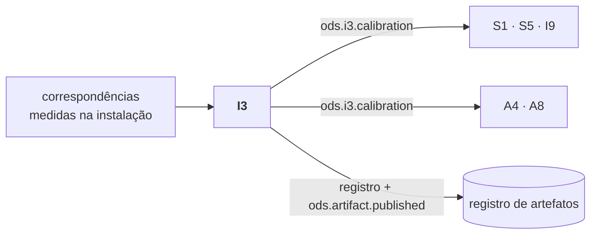

# I3 · geometria e calibração de câmera

[](https://github.com/ods-26-2/i3/actions/workflows/i3-tests.yml)

**Converte o que a câmera vê em medidas do mundo real.** Componente da camada 2 (inferência) do
ODS 2026/2, do squad INV-1. Produz o artefato **CALIBRATION** de cada câmera: intrínsecos,
distorção e a homografia do pixel bruto para metros no plano do chão. É artefato versionado, não
serviço: o I3 roda quando a câmera é instalada ou se mexe, e o resultado fica no registro.



Serve a qualquer instalação. A 6c calibra na 1.0 as câmeras do A4 (quadra), do A8
(estacionamento) e do A5 (galpão): o I3 fornece o procedimento genérico, e cada aplicação
fornece as medidas e o referencial da sua instalação.

## Início rápido

```bash
docker build -t inv-i3 .
docker run -i --rm inv-i3 --source-id cam0 < correspondencias.csv > calibracao.json
docker run -i --rm --network host inv-i3 --source-id cam0 --kafka localhost:9092 < correspondencias.csv
#   Kafka da Jetson (rede do DCOMP): --kafka 172.18.4.56:9092
```

**Entrada (stdin):** um csv `u,v,x,y,uso,ponto`. `u,v` em pixels do quadro bruto; `x,y` em metros
no plano do chão; `uso` é `ajuste` (entra no cálculo), `holdout` (só mede o erro) ou `pular`
(ocluso). São necessários 4 pontos de ajuste e pelo menos 1 de holdout. Linhas com `#` são
comentário.

**Saída:** um evento `ods.i3.calibration` no envelope da 6c, validado contra
[`schemas/`](schemas/) antes de sair. Vai para o stdout como arquivo; com `--kafka`, para o tópico
de mesmo nome, chave `source_id`.

O passo a passo está em [HOW_TO_RUN.md](HOW_TO_RUN.md); o contrato, a semântica e a operação, em
[docs/CONTRATO.md](docs/CONTRATO.md).

## Opções

| opção | para quê |
|---|---|
| `--source-id` | a câmera, pelo nome do cadastro da instalação |
| `--versao` | `artifact_version` (padrão `cal-<source_id>-1`); uma versão nunca muda de conteúdo |
| `--espaco`, `--origem`, `--eixos` | o referencial da instalação: `space_id` (o mesmo das zonas) e, em texto, onde fica a origem e como correm os eixos |
| `--largura`, `--altura` | tamanho do quadro calibrado (com `--linhas`, o da imagem) |
| `--valido-desde` | ISO 8601 com fuso; padrão é agora |
| `--registro PASTA` | grava o CALIBRATION no registro com o descritor comum; com `--kafka`, anuncia em `ods.artifact.published` |
| `--kafka HOST:PORTA` | publica no broker em vez do stdout |
| `--linhas IMAGEM` | mede as linhas pintadas do chão nessa imagem, sem clique (seção abaixo) |
| `--padrao ARQUIVO` | com `--linhas`: o desenho das linhas do chão em metros (`padroes/`) |
| `--perto LINHA` | com `--linhas`: a linha do padrão mais perto da câmera, quando o desenho é simétrico |

## Uma calibração por aplicação

```bash
# A8, estacionamento: cada câmera do pátio com o mesmo space_id
docker run -i --rm inv-i3 --source-id cam-patio-2 --versao cal-cam-patio-2-1 --espaco patio-1 \
    --origem "canto sudoeste do patio" --eixos "x ao longo da rua, y para o fundo" < patio_cam2.csv

# A4, vôlei: o referencial que a regra do A4 usa (origem no canto, x ao longo dos 18 m)
docker run -i --rm -v $PWD/dados:/dados inv-i3 --source-id cam0 --versao cal-cam0-3 --espaco quadra-volei-fivb \
    --origem "canto proximo esquerdo" --eixos "x ao longo dos 18 m, y afastando da camera" \
    --linhas /dados/quadra_mediana.png --padrao padroes/quadra-volei-fivb.json --perto "lateral y=0" < /dev/null
```

## A métrica

**Erro de reprojeção fora do ajuste, em centímetros no plano:** o rms de pontos conhecidos que
não entraram no cálculo. O erro nos pontos do ajuste é otimista por construção (0,3 cm contra
0,9 cm em pontos novos, na primeira medição). Vai em `reprojection_rms_cm`, com o número de pontos
em `holdout_points`.

## Calibração pelas linhas do chão, sem clique

Serve a qualquer instalação com faixas pintadas no chão: quadra, vagas de estacionamento, marcas
de piso (`I3/geometria/linhas.py`, opções `--linhas`, `--padrao` e `--perto`).

- **O padrão é da instalação.** Um json com as linhas em metros, no referencial que vai no
  CALIBRATION (destro, z para cima): `{"nome": ..., "linhas": [{"nome", "de": [x, y], "ate": [x, y]}]}`,
  com pelo menos 2 linhas em cada uma de duas direções. A quadra FIVB é
  `padroes/quadra-volei-fivb.json`; as vagas de um pátio são outro arquivo, da aplicação.
- **O I3 acha o padrão na imagem.** Os trechos contínuos de faixa clara viram retas; cada 2 retas
  casadas com 2 linhas de uma direção e 2 da outra dão uma homografia, que vale pelo quanto do
  padrão projetado cai sobre faixa. A câmera está acima do chão, então o padrão nunca aparece
  espelhado. Desenho simétrico (a quadra) aparece de dois jeitos: `--perto` diz qual linha fica
  mais perto da câmera, e o I3 recusa sem ela.
- **Pontos no olho são opcionais.** Um csv no stdin, se vier, substitui a busca como ponto de
  partida.

Na quadra do A4, sem clique: os cantos caem a 0,3 px dos da medição com os pontos no olho, com
1,21 cm fora do ajuste (1,43 cm partindo dos pontos; a diferença é o conjunto de pontos de linha
que entra, não uma calibração melhor). Os testes também calibram, em imagens sintéticas com
logo, faixa de outra modalidade e manchas, a quadra e um pátio de 6 vagas.

### Procedimento de bancada · quadra do A4 (card I3.3)

O padrão é a própria quadra de vôlei FIVB, 18 × 9 m:

1. **Câmera fixa.** Conferir que a quadra não anda entre trechos do jogo (na câmera do A4, menos
   de 1 px em 8 min). Se andar, uma calibração por trecho.
2. **Imagem sem jogadores.** Mediana de dezenas de quadros espalhados pelo jogo
   (`dados/quadra_mediana.png`: 80 quadros do vídeo do A4).
3. **Linhas no subpixel.** A cada 25 cm ao longo de cada linha (laterais, fundos e ataques), um
   perfil perpendicular acha o centro da faixa branca pelo centroide do brilho, a partir da
   quadra achada na imagem (ou dos pontos de `dados/pontos_quadra.csv`).
4. **Homografia pelas linhas.** Ajuste que põe cada ponto medido sobre o eixo da sua linha, com a
   geometria FIVB: linha de 5 cm, as de fronteira dentro da quadra, a de ataque com a borda de trás
   a 3 m do eixo da central. Ponto a mais de 3 desvios (pela mediana) da sua linha sai e o ajuste
   refaz: poste, logo e oclusão saem sozinhos.
5. **Erro fora do ajuste.** Cada linha em terços; cada terço sai do ajuste e é medido contra a sua
   reta. É esse rms que vai em `reprojection_rms_cm`.
6. **Intrínsecos.** Focal pelos cruzamentos das linhas medidas, centro ótico no meio da imagem.

Medido na câmera do A4 (`cal-cam0-2`): **1,43 cm fora do ajuste**, 253 pontos de linha. Os 8
pontos marcados no olho davam 14,7 cm. Uma distorção radial de um termo baixava para 1,19 cm, mas
a 6c pede homografia sobre o pixel bruto, que a distorção não deixa exata; fica sem distorção.

Ferramentas de bancada (fora do container, precisam de numpy e opencv):
`I3/ferramentas/conferir_quadra.py` reprojeta a quadra sobre a foto e
`I3/ferramentas/medir_linhas.py` escreve os cruzamentos das linhas medidas como csv.

## Estrutura

```
I3/
├── geometria/
│   ├── homografia.py    DLT normalizado, pixel -> mundo, erro de reprojeção (núcleo genérico)
│   ├── intrinsecos.py   focal pelos pontos do plano
│   ├── entrada.py       o csv de correspondências, com erro por linha
│   ├── artefato.py      evento ods.i3.calibration, registro e anúncio
│   ├── contrato.py      validação contra os schemas
│   ├── publicacao.py    stdout ou Kafka
│   └── linhas.py        calibração pelas linhas pintadas do chão, sem clique
├── ferramentas/         conferir_quadra.py e medir_linhas.py (bancada do A4)
├── tests/               suíte (python -m unittest discover -s I3/tests -t I3)
└── run_calibracao.py    linha de comando
padroes/                 desenhos de linhas do chão em metros (quadra FIVB)
schemas/                 ods.i3.calibration e ods.artifact.published, com exemplos válidos e inválidos
dados/                   a instalação do A4: pontos, imagem mediana e conferência
main.py                  ponto de entrada (Docker, B4, cadeia)
```

Parte do INV-1 · ODS 2026/2, com [I2](https://github.com/ods-26-2/i2) (identidade e rastreio) e
[A4](https://github.com/ods-26-2/a4) (arbitragem). Nenhum importa o outro: eles conversam pelo
Kafka, no envelope da Arquitetura 6c.
